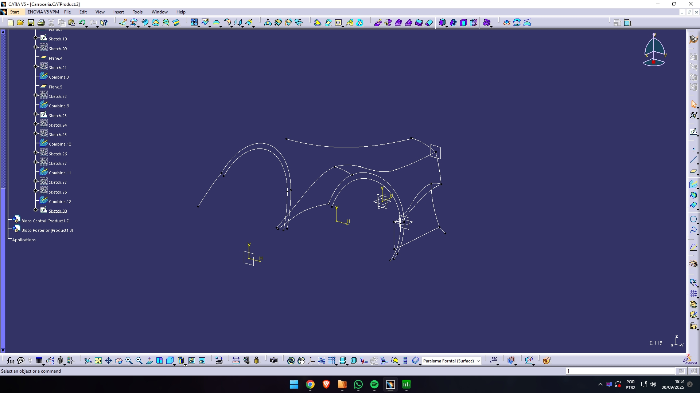

<p align="center"></p>

<h1 align="center">🚘 Concept Car Design</h1>

<p align="center"><em>Visualização interativa de um conceito automotivo 3D.</em></p>

<p align="center">🇧🇷 Português | 🇺🇸 <a href="README.en.md">English</a></p>

<p align="center"> </p>

<p align="center"><a href="#sobre">Sobre</a> • <a href="#tecnologias">Tecnologias</a> • <a href="#como-rodar">Como rodar</a> • <a href="#licenca">Licença</a> • <a href="#autor">Autor</a></p>

---

<a id="sobre"></a>
## 📖 Sobre

Projeto demonstrativo que utiliza Three.js para carregar o arquivo STL de um veículo, com câmera orbital, zoom, grade e alternância de materiais.

## ✨ Funcionalidades

- Visualização do modelo STL
- Controles de órbita, zoom e pan
- Troca de material pela tecla T

<a id="tecnologias"></a>
## 🛠️ Tecnologias

   

## 📦 Pré-requisitos

Servidor HTTP local e acesso à internet para carregar módulos Three.js.

<a id="como-rodar"></a>
## 🚀 Como rodar

```bash
git clone https://github.com/Felipe-Amorim-Dev/Concept-Car-Design.git
cd Concept-Car-Design
python -m http.server 8000
```

## 📸 Demonstração

[Acessar projeto](https://felipe-amorim-dev.github.io/Concept-Car-Design/)

## 🔗 Repositórios relacionados

[CAD-Viewer](https://github.com/Felipe-Amorim-Dev/CAD-Viewer) — Biblioteca de visualização 3D.

## 🏗️ Organização e implementação do projeto

- O projeto concentra a experiência 3D em index.html, com importação de módulos Three.js pela CDN.
- STLLoader lê assets/Concept_Car.stl; OrbitControls implementa rotação, pan e zoom.
- WebGLRenderer desenha a cena, enquanto iluminação Hemisphere/Directional/Ambient e GridHelper compõem a apresentação.
- Ao carregar a geometria, o código recalcula normais, centraliza o modelo e ajusta sua escala.
- A tecla T alterna MeshPhysicalMaterial e MeshNormalMaterial; resize atualiza proporção da câmera e viewport.

### Estrutura e recursos

Os principais arquivos e recursos estão em `assets/Concept_Car.stl`. O ponto de entrada é `index.html`.

<a id="licenca"></a>
## 📄 Licença

Distribuído sob a [licença MIT](LICENSE).

<a id="autor"></a>
## 👤 Autor

**Felipe Figueiredo Amorim** — Desenvolvedor Full Stack.

[](https://www.linkedin.com/in/felipe-amorim-dev/) [](mailto:felipe.f.amorim@outlook.com)

<p align="center"><strong>Obrigado por visitar! / Thanks for visiting!</strong></p>
